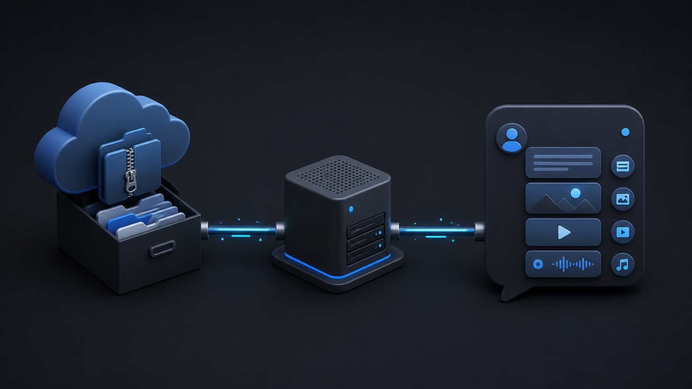

<p align="center">
  
</p>

<h1 align="center">VK Content Bot</h1>

<p align="center">
  VK-бот для выдачи текста, медиа и кнопок по ключевым фразам.
</p>

<p align="center">
  
  
  
  
</p>

Редактор меняет ключевые слова, тексты, файлы, fallback и кнопки в разделе **Автоответы** BotCRM. Пересобирать бота для нового контента не нужно. Directus остаётся внутренним хранилищем платформы: бот не знает его адрес и не получает административный токен.

## Как это работает

```text
Пользователь VK
       │
       ▼
VK Content Bot ──► BotCRM Content API ──► ответ, медиа, кнопки
       │
       └──► VK API

Яндекс Диск ──► media worker ──► VK attachment ID ──► BotCRM
```

Файл с Яндекс Диска передаётся во VK один раз. После этого бот использует сохранённый VK ID и не скачивает оригинал на каждый запрос.

## Возможности

- точное совпадение, фраза внутри сообщения, любое или все слова;
- приоритеты правил и нормализация текста;
- текст, фото, видео, аудио и документы в любом порядке;
- inline-кнопки команд и ссылок;
- полноценный fallback-ответ;
- фоновая подготовка закрытых файлов с Яндекс Диска;
- изоляция контента персональным токеном BotCRM;
- кеш правил, structured logging и graceful shutdown.

> **Наполняете бота?** Откройте [инструкцию редактора](docs/CONTENT_GUIDE.md): в ней показано, как собрать текст, медиа, кнопки и ответ по умолчанию в BotCRM.

## Локальная разработка

Сначала запустите BotCRM с внутренней контентной инфраструктурой. Затем в BotCRM откройте **Автоответы**, выберите бота и создайте для него персональный токен.

```bash
cd ../botcrm
docker compose -f infra/docker-compose.yml up -d
```

Затем запустите бота:

```bash
cp .env.example .env
# заполните VK_TOKEN, BOTCRM_CONTENT_TOKEN и остальные значения
docker compose up -d --build bot
docker compose logs -f bot
```

Для запуска без Docker укажите `BOTCRM_URL=http://localhost:4100/api/v1`, затем:

```bash
npm ci
npm run dev
```

## Проверки

```bash
npm run format:check
npm run lint
npm run typecheck
npm test
npm run build
docker build --target runtime .
```

CI выполняет эти проверки для push и pull request, а также собирает ARM64-образ.

## Конфигурация

| Переменная                     | Назначение                                                |
| ------------------------------ | --------------------------------------------------------- |
| `VK_TOKEN`                     | Токен сообщества VK                                       |
| `VK_VIDEO_TOKEN`               | Пользовательский OAuth-токен для загрузки видео           |
| `VK_VIDEO_REFRESH_TOKEN`       | Refresh token VK ID для автоматического продления         |
| `VK_VIDEO_DEVICE_ID`           | Идентификатор устройства из OAuth-ответа                  |
| `VK_VIDEO_CLIENT_ID`           | ID приложения VK ID                                       |
| `VK_VIDEO_TOKEN_EXPIRES_AT`    | Срок действия access token в Unix time                    |
| `VK_GROUP_ID`                  | Числовой ID сообщества                                    |
| `VK_MEDIA_UPLOAD_PEER_ID`      | ID аккаунта для загрузки фото и документов                |
| `BOTCRM_URL`                   | API единого центра управления ботами                      |
| `BOTCRM_CONTENT_TOKEN`         | Персональный токен контента, созданный в BotCRM           |
| `YANDEX_DISK_TOKEN`            | OAuth-токен Диска; можно оставить пустым для текста       |
| `RULE_CACHE_TTL_SECONDS`       | Кеш ключевых правил, по умолчанию 30 секунд               |
| `MEDIA_UPLOAD_TIMEOUT_SECONDS` | Лимит времени загрузки файла во VK, по умолчанию 30 минут |

Полный список есть в [.env.example](.env.example).

Токен видео получается через VK ID OAuth 2.1 с PKCE. Refresh token и его обновлённые значения хранятся в отдельном Docker volume `vk_video_auth`. Бот обновляет access token за пять минут до истечения и не выводит токены в логи.

## Релизы

В репозитории приняты Conventional Commits и SemVer:

- `fix:` → patch;
- `feat:` → minor;
- `feat!:` или `BREAKING CHANGE:` → major.

Workflow `Release` принимает новую SemVer-версию, собирает образы, создаёт tag и GitHub Release с автоматическими notes:

```text
ghcr.io/evgenykravchenko/vk-content-bot:0.2.0
ghcr.io/evgenykravchenko/vk-content-bot:0.2
```

Production фиксирует точную версию. `latest` не используется. Порядок выкатки и rollback: [docs/PRODUCTION.md](docs/PRODUCTION.md).

## Структура

```text
src/                     бизнес-логика и интеграции
tests/                   unit-тесты
deploy/                  безопасный пример production env
scripts/                 deployment и healthcheck
docs/                    инструкции
.github/workflows/       CI, release, image publish, deploy
compose.yaml             локальный запуск
compose.production.yaml  production override
```

## Приватность медиа

Бот не публикует материалы на стене. Для видео используются `wallpost: 0`, `is_private: 1` и отключённые комментарии. Уже полученный файл пользователь всё равно может переслать или записать с экрана: это не DRM.

MIT License.
